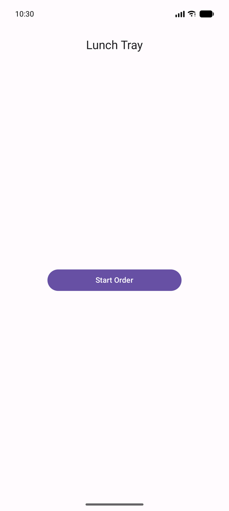
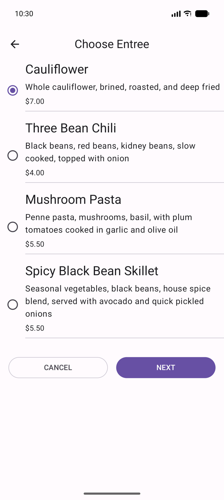
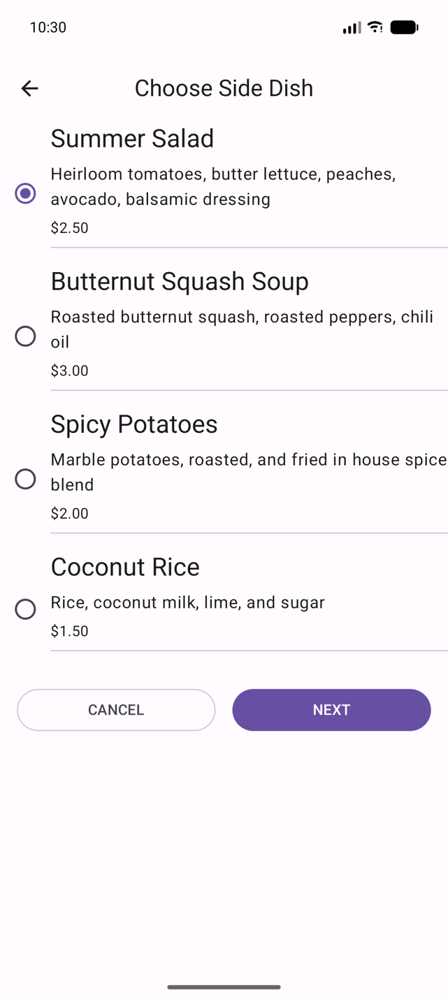
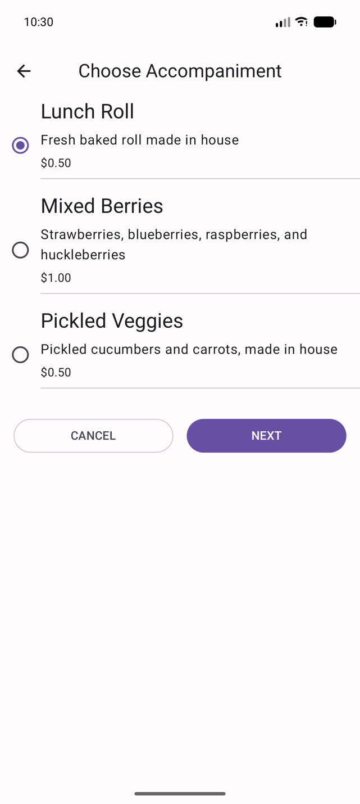
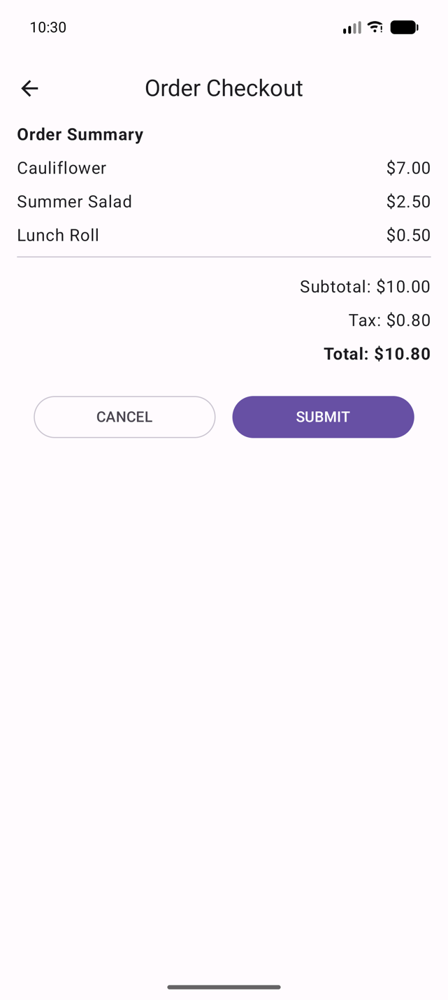

# Unit 4 · Pathway 2 — Navigation in Jetpack Compose

## 1. Navigate between screens with Compose (Cupcake)
Выполнено по шагам кодлаба (коммиты `unit 4 pw2 4.` … `7.`): маршруты `CupcakeScreen`,
`NavHost` + `NavHostController`, переходы между экранами, отправка заказа в другое приложение
через `Intent.ACTION_SEND`, App Bar с кнопкой «Назад».

## 2. Test the Cupcake app
Инструментальные тесты `CupcakeOrderScreenTest` и `CupcakeScreenNavigationTest`
(`TestNavHostController`, `createAndroidComposeRule`) — 13/13 проходят на Pixel 10 Pro (API 37).

Для запуска на API 37 обновлены `espresso-core` 3.5.1 → 3.7.0 и `androidx.test.ext:junit` 1.1.5 → 1.3.0:
старый Espresso вызывал удалённый скрытый метод `InputManager.getInstance()` и все Compose-тесты падали
с `NoSuchMethodException`.

## 3. Practice: Add navigation (Lunch Tray)
- **Screen enum** — `LunchTrayScreen` (Start, Entree, SideDish, Accompaniment, Checkout) с заголовками.
- **Navigation controller** — `rememberNavController()`, текущий экран из `currentBackStackEntryAsState()`.
- **AppBar** — `LunchTrayAppBar`: заголовок текущего экрана, кнопка «Назад» везде, кроме Start.
- **Navigation host** — `NavHost` с пятью маршрутами; Cancel и Submit сбрасывают заказ и возвращают на Start
  через `popBackStack(Start, inclusive = false)`.
- Добавлен `LunchTrayScreenNavigationTest` — 8/8 тестов проходят.

| Start | Entree | Side dish | Accompaniment | Checkout |
|---|---|---|---|---|
|  |  |  |  |  |

## 4. Quiz
_Скриншот прохождения квиза добавить вручную._
