# Unit 4 · Pathway 3 — Adaptive layouts

## 1. Build an adaptive app with dynamic navigation (Reply)
- **Change screens without a navigation graph** — `ReplyHomeScreen` переключает список/детали по
  `isShowingHomepage`, системная кнопка «Назад» обрабатывается `BackHandler`.
- **Make your layout adapt to different screen sizes** — `material3-window-size-class`,
  `calculateWindowSizeClass(this)` в `MainActivity`, `WindowWidthSizeClass` передаётся в `ReplyApp`.
- **Implement adaptive navigation layout** — `ReplyNavigationType`: Compact → `NavigationBar`,
  Medium → `NavigationRail`, Expanded → `PermanentNavigationDrawer`.

## 2. Build an app with an adaptive layout (Reply)
- Превью для Compact / Medium (700dp) / Expanded (1000dp).
- `ReplyContentType` (`LIST_ONLY`, `LIST_AND_DETAIL`): на Expanded список и детали письма показываются рядом,
  `ReplyDetailsScreen(isFullScreen)`, «Назад» в режиме list-detail закрывает приложение.
- Тесты `ReplyAppTest`, `ReplyAppStateRestorationTest` (`StateRestorationTester`) и аннотации
  `@TestCompactWidth` / `@TestMediumWidth` / `@TestExpandedWidth`.
  Compact и Medium тесты проходят на Pixel 10 Pro, Expanded — на том же эмуляторе с `wm size 2560x1600`, `wm density 320`.

| Compact: список | Compact: детали | Medium: navigation rail |
|---|---|---|
| 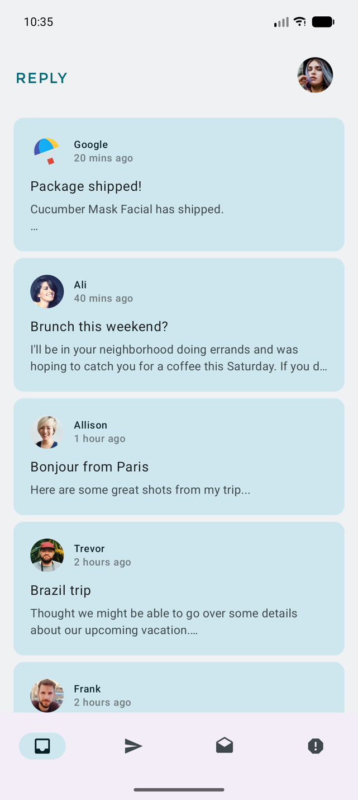 | 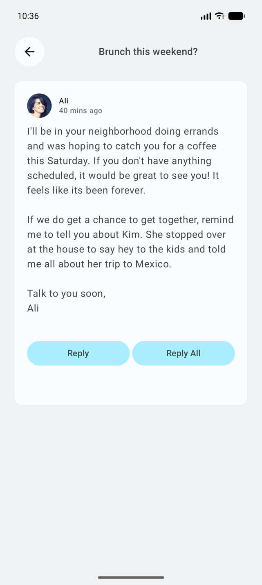 | 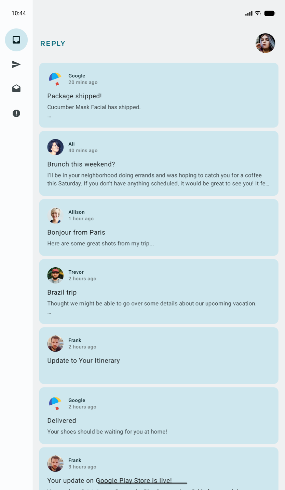 |

Expanded: permanent navigation drawer + список и детали

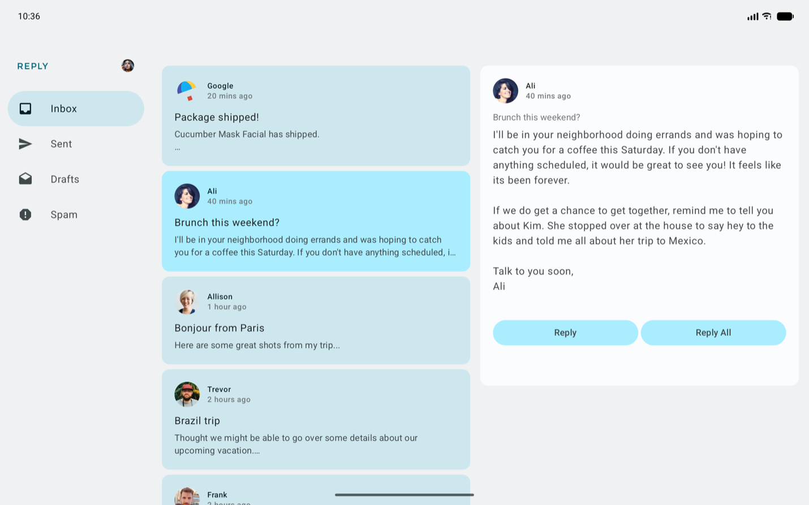

## 3. Practice: Build Sports app
- `SportsListAndDetails` — список и детали рядом (веса 2:3), превью на `Devices.TABLET`;
  «Назад» на этом экране закрывает приложение (`(LocalContext.current as Activity).finish()`).
- `material3-window-size-class`: `calculateWindowSizeClass` в `MainActivity`, в `SportsApp`
  Expanded → `SportsContentType.ListAndDetail`, иначе `ListOnly`.
- `SportsAppBar` на Expanded не показывает кнопку «Назад» и всегда показывает заголовок «Sports».

| Compact: список | Compact: детали |
|---|---|
| 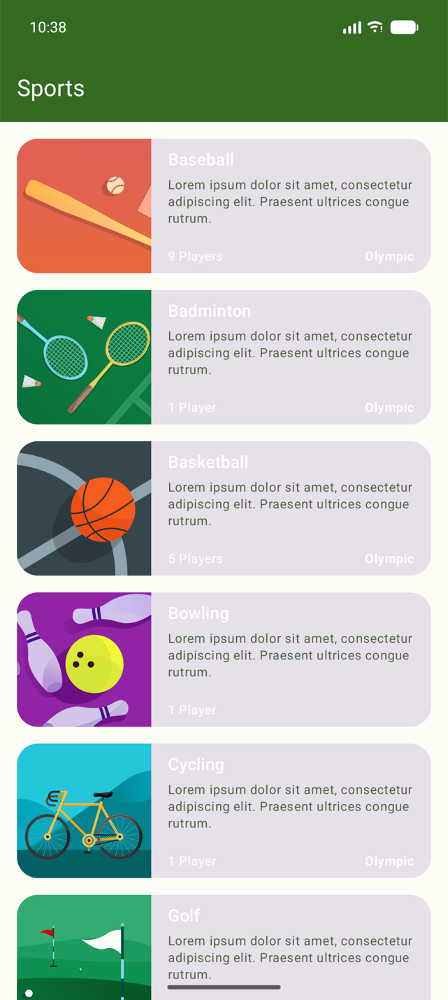 | 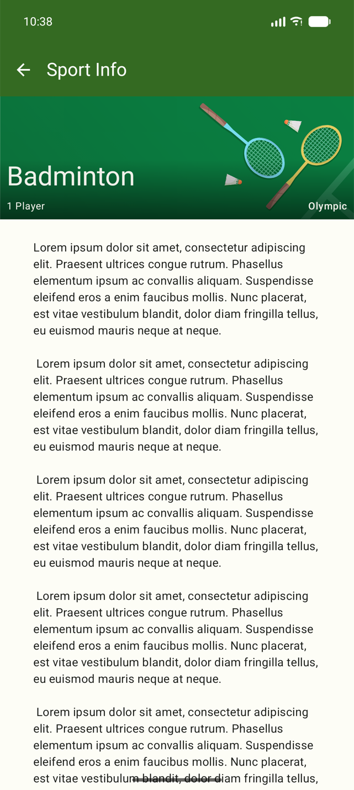 |

Expanded: список и детали

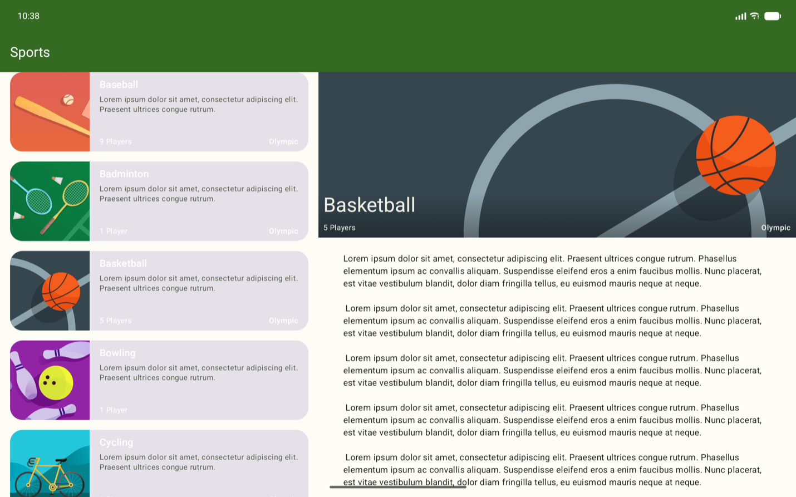

## 4. Project: Create a My City app — «Моя Казань»
Эскизы и план: [my_city_plan.md](my_city_plan.md).

- **Контент:** 5 категорий (достопримечательности, музеи, парки и набережные, театры, татарская кухня) × 4 места;
  данные отделены от UI: `model/Category`, `model/Place`, `data/LocalPlacesDataProvider`, строки в `strings_city.xml`.
- **Состояние:** `MyCityViewModel` + `MyCityUiState` (`StateFlow`, однонаправленный поток данных), unit-тесты `MyCityViewModelTest`.
- **Навигация:** Jetpack Navigation, маршруты `Categories → Places → Details`, `TopAppBar` с заголовком и кнопкой «Назад».
- **Адаптивность** (`WindowWidthSizeClass`):
  Compact — отдельный экран категорий; Medium — `NavigationRail`; Expanded — `PermanentNavigationDrawer`
  + список и детали рядом, «Назад» закрывает приложение.
- **Тесты:** `MyCityAppTest` (навигация и раскладки для трёх размеров) — 7/7 на телефоне и на эмуляторе
  с размером окна 2560×1600 @ 320dpi.

| Compact: категории | Compact: места | Compact: детали |
|---|---|---|
| 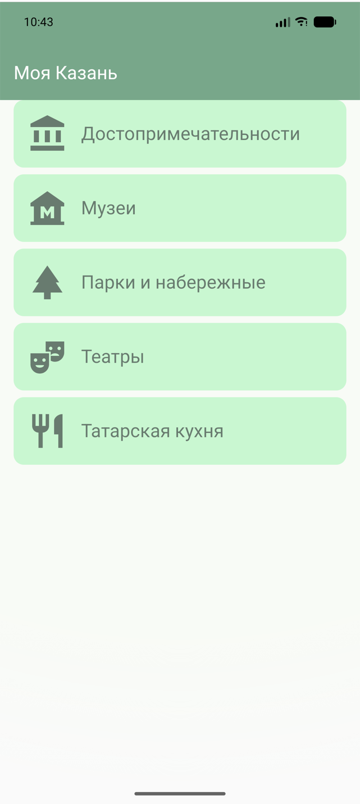 | 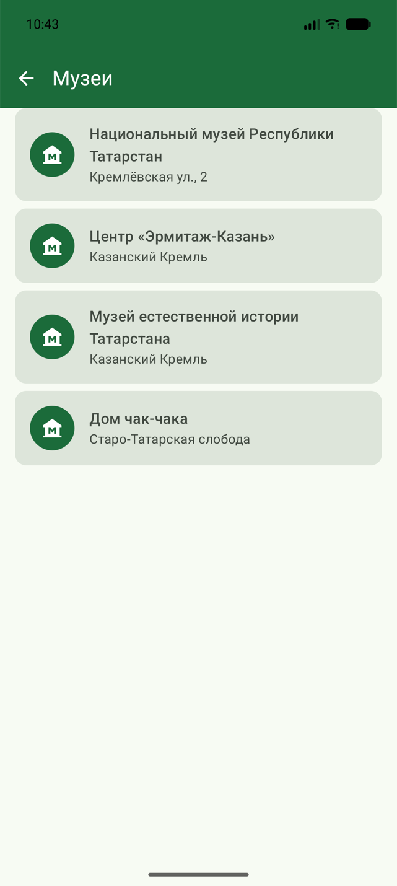 | 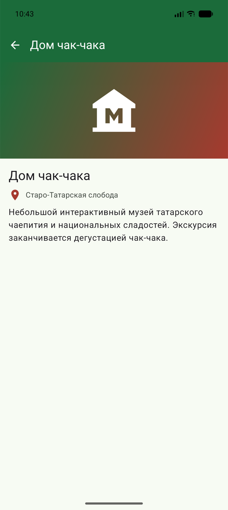 |

| Medium: navigation rail | Medium: детали |
|---|---|
| 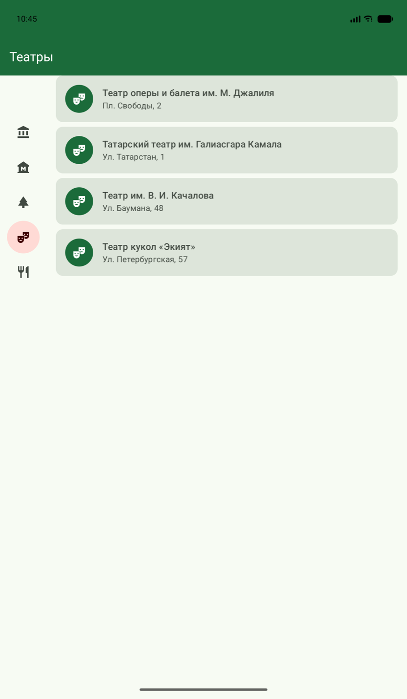 | 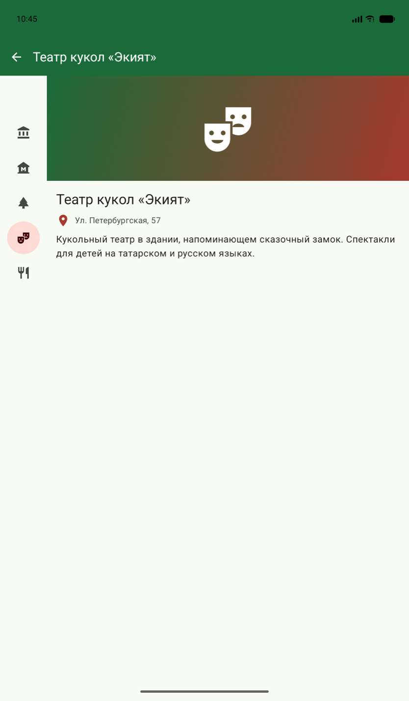 |

Expanded: боковое меню + список + детали

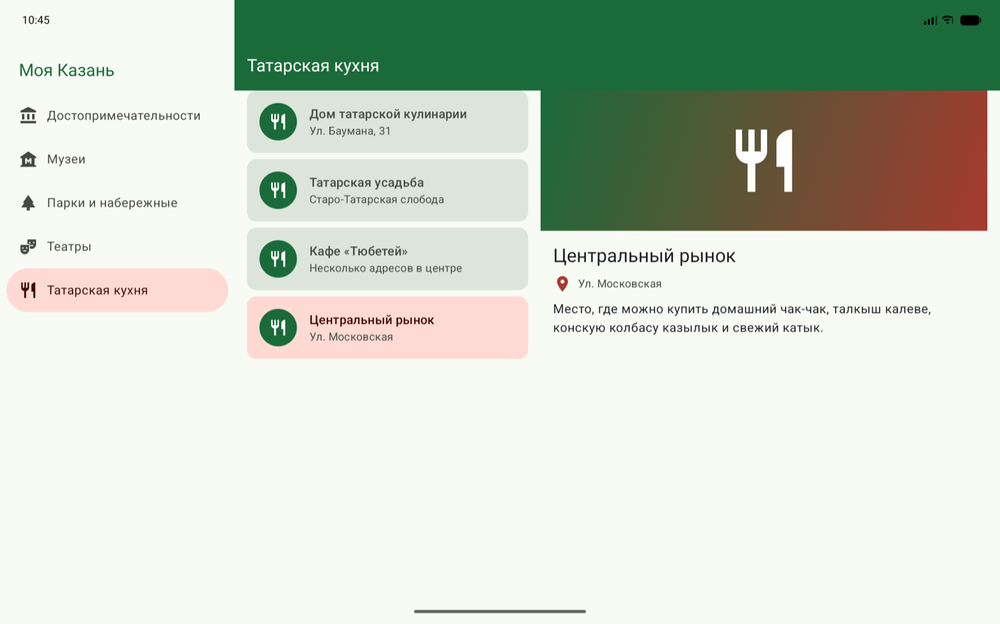

## 5. Quiz
_Скриншот прохождения квиза добавить вручную._
